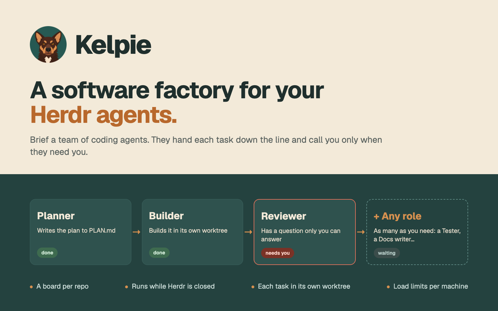
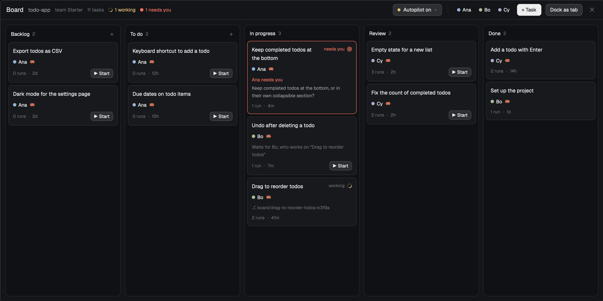
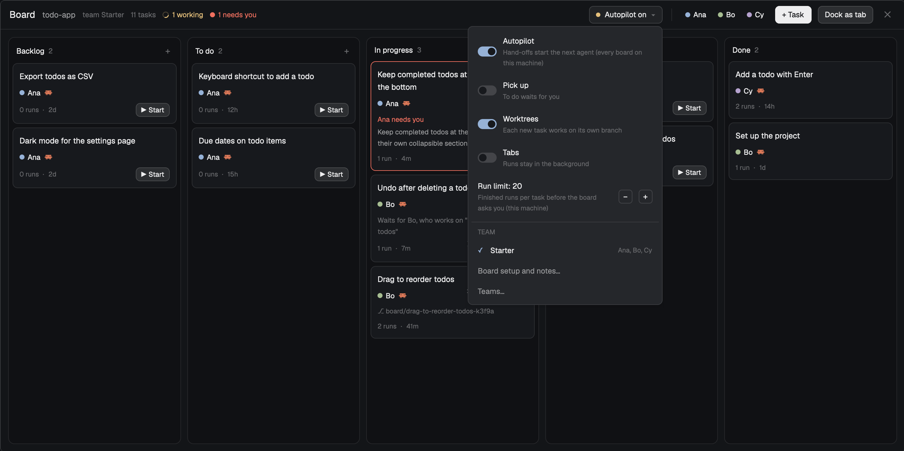
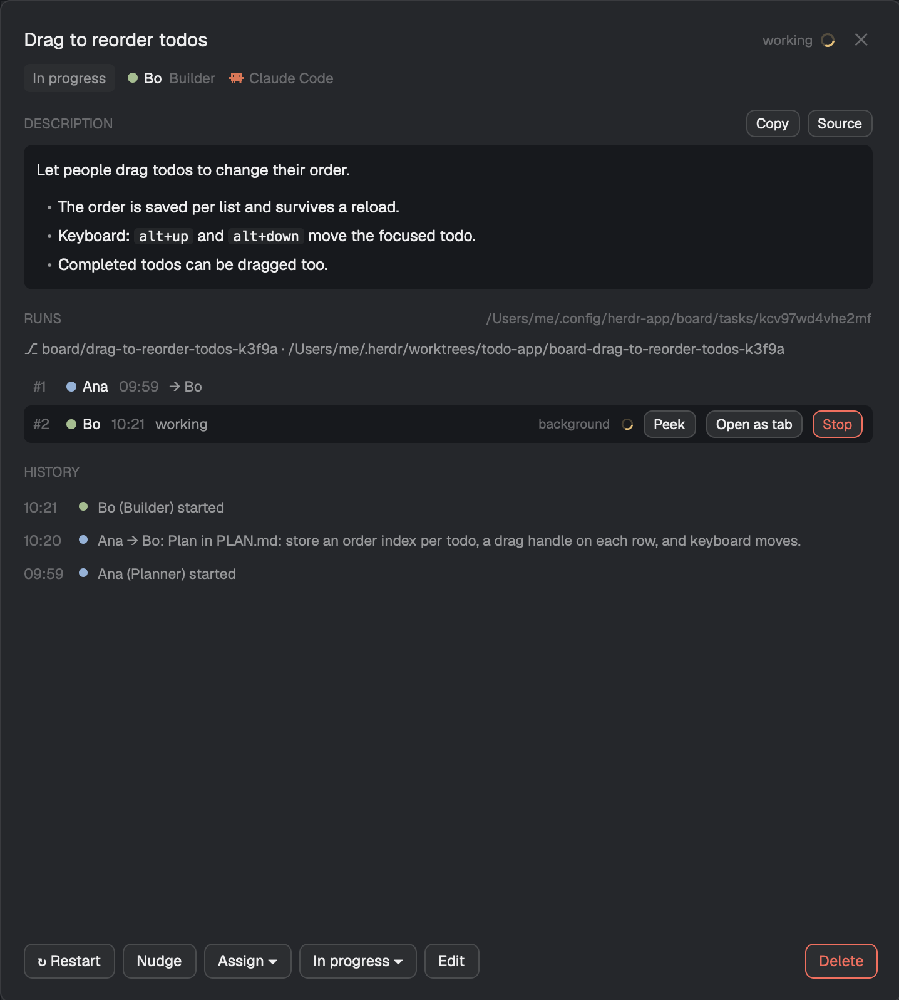
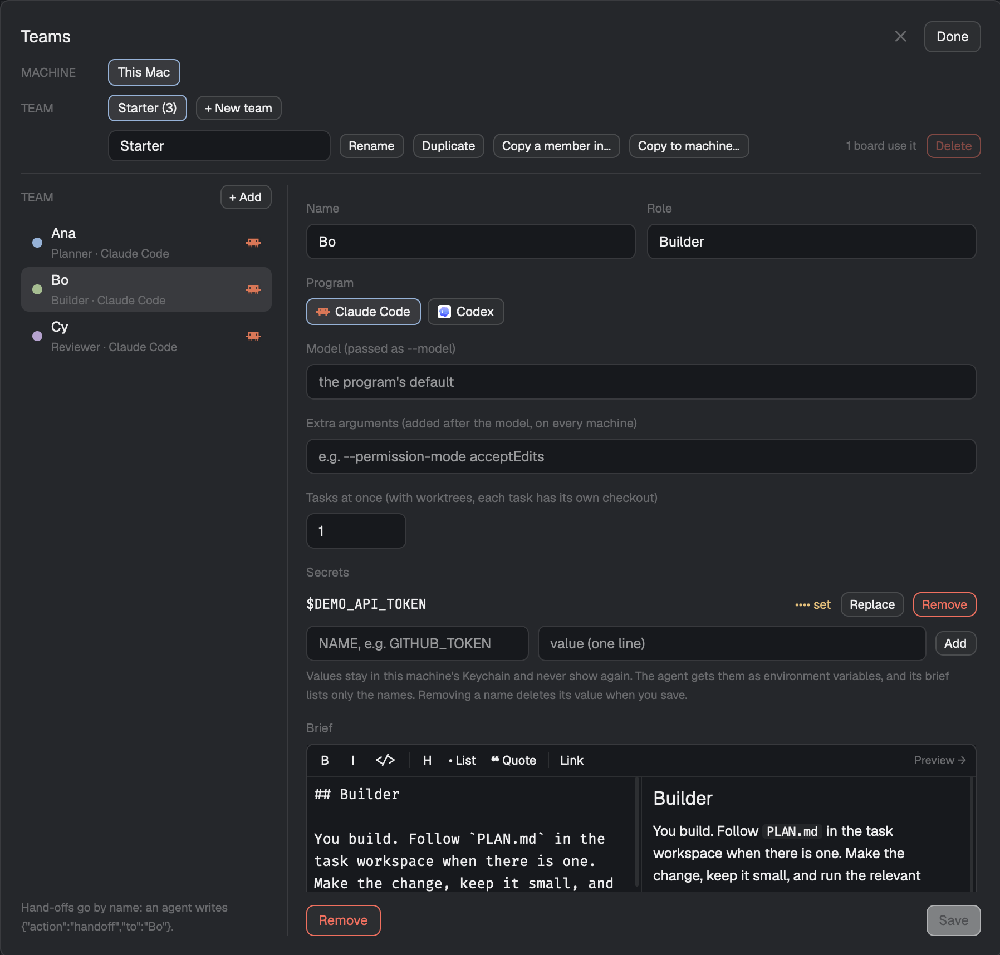

# Board for Herdr

A kanban board for coding agents in the [Herdr](https://herdr.dev) app. Each repository or worktree folder gets a board with five columns: Backlog, To do, In progress, Review, Done. A team of agents works the tasks. Each member has a name, a role, a brief and a program: Claude Code or Codex. The members hand each task on to the next. If a card says it needs you, you step in.

## Screenshots

| | |
|---|---|
|  |  |
| The board: a working task, a task that needs you, and a hand-off waiting for a busy member | The settings menu: Autopilot, Pick up, Worktrees, Tabs, the run limit and the board's team |
|  |  |
| A task: its description, runs, worktree and history | The Teams window: a member, and a secret that is set |

## Install

1. Copy the `board/` folder into `~/.config/herdr-app/mods/`.
2. Open the board:
   - as a window: `herdr-app do mod.open --name board`, or
   - as a tab in a space: `herdr-app do tab.new --name Board --space <space id> --mod board --props '{"space":"<space id>"}'`.
3. The first time a board opens, it installs a small engine on this Mac, and on every Mac that Herdr is connected to. The engine starts the agents. A new engine comes with a "Starter" team: a Planner, a Builder and a Reviewer. Edit them, or make your own teams in "Teams…" in the board's menu.

You need macOS, Node, git, and `claude` or `codex` on each Mac that runs agents.

## What it installs and does

Read this before you install it:

- **A background service on each Mac.** It installs a launchd user agent, `dev.herdr.board`, which runs `board/engine/engine.mjs` with Node. The service keeps the board working while Herdr is closed. Its files are in `~/.config/herdr-app/board` on this Mac and in `~/.herdr/board` on other Macs.
- **Agents and commands, here and on other machines.** It starts `claude` or `codex` agents on every Mac that Herdr is connected to, through herdr-core. It also runs `git`, `hc`, `security`, `launchctl` and `ps` there.
- **Git worktrees and branches.** Each task gets its own worktree, under `~/.herdr/worktrees/<repo>/`, on a branch named `board/…`. It never deletes a worktree that has changes.
- **Secrets in the macOS Keychain.** A member's secrets are kept in the Keychain of its machine, under the service `herdr-board`. Agents get them as environment variables. The values never go into the board's files.
- **Chrome cleanup.** After an agent writes its result, the engine closes the Chrome that agent started, and only that one. Agents that sit idle after their run are closed after 15 minutes.
- **No network calls of its own.** The board itself only talks to your machines. The agents it starts use their own network as usual.

## Using it

- Add a task with "+ Task", give it a member, and drag it into In progress. That member starts. Members hand the task on until one reports it done, and it lands in Review.
- **Pick up** (in the menu) lets members with room take To do tasks by themselves.
- **Tasks at once** (in Teams) sets how many tasks a member works on at the same time. It counts per board.
- **Unblock in tab ↗** (on a card that needs you, and in its task dialog) opens a tab with Claude in the task's space. It writes `UNBLOCK.md` into the task folder first: why the task needs you, the waiting question, the description, the team, every run and hand-off, and the notes to read. The session talks it through with you and acts on the board only after you agree.
- **Board setup and notes…** sets a command for each new worktree, for example `npm ci`. It also holds notes for every agent's brief, and your standing answers to questions that agents ask often.

`board/README.md` describes how it is built, and `RECIPE.md` describes how to build it from scratch.

## License

MIT, see [LICENSE](LICENSE).
