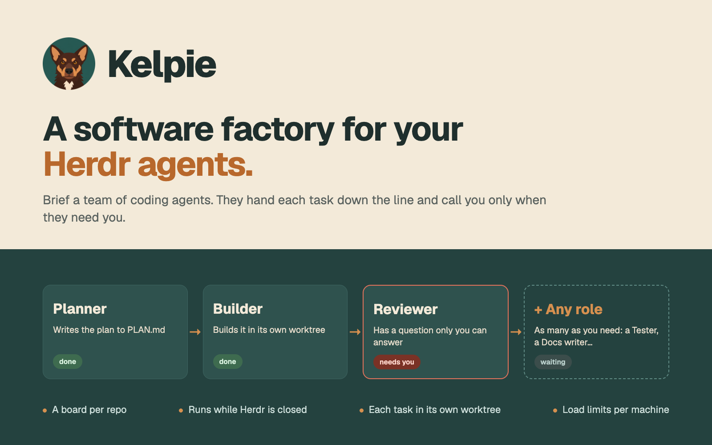

# Board

A kanban board for coding agents in Herdr. Each checkout (a repository or a worktree folder) has its own board with five columns. A team of agents works the tasks. Each member has a name, a role, a brief and a program: Claude Code or Codex. A member writes a result file to hand a task to the next member, or to report done or blocked. A small engine on each Mac runs the agents, so the board keeps working while the Herdr app is closed.

## What you see

- **Header (46 px):**
  - "Board", the space's name and the board's team.
  - The task count, "N working" with a spinner, and "N needs you" with a red dot.
  - On the right: the "Autopilot on ▾" menu button, a chip for each member and "+ Task".
  - If the board is a window, "Dock as tab" and ✕ follow.
- **Five columns:** Backlog, To do, In progress, Review, Done. Each has a task count, and Backlog and To do each have a + button. The columns share the width (each at least 170 px) and scroll on their own.
- **Cards (rounded 8 px, surface background),** newest change first. A card shows:
  - The title, and the run's status on the right: "working" with a spinner, "needs you" with a red dot, "finished", "idle", or "usage limit".
  - The member chip with the program icon and the model.
  - If the task has its own worktree: "⎇ <branch>".
  - A wait line: "Waits for Bo, who works on "<title>"", or "Waits for the usage limit to reset at 10pm".
  - If the task needs the person: a red note and a red border.
  - "N runs · 2h". If the task needs the person, "Unblock ↗" follows. If the task has an assignee and no run, "▶ Start" follows.
- **Task dialog:**
  - The status and the column chip, then the member, the program and the model.
  - The description, rendered as markdown, with Copy and Source.
  - Attachments.
  - Runs: the task folder, and the worktree branch and path. Each run shows its member, start time, status and result, with Peek, "Open as tab" and Stop.
  - History, newest first.
  - The actions: "Unblock in tab ↗" (only when the task needs the person), Start, Restart, Nudge, Assign ▾, the column ▾, Edit, Close finished runs, and Delete.
- **Settings menu ("Autopilot on ▾"):**
  - The switches Autopilot, Pick up, Worktrees and Tabs, each with its own hint line.
  - "Run limit: 20" with − and +.
  - A TEAM list with a check next to this board's team, then "Board setup and notes…" and "Teams…".
- **Teams window:**
  - A machine picker, the team chips with member counts, "+ New team", and Rename, Duplicate, "Copy a member in…", "Copy to machine…" and Delete. Delete is turned off while a board uses the team.
  - The member list, and the member form:
    - Name and Role.
    - The program chips.
    - Model.
    - Extra arguments.
    - Tasks at once.
    - Secrets: each name shows "•••• set" or "not set", with Replace and Remove.
    - A markdown brief editor whose source and preview scroll together.
    - The hand-off chips.
    - The colour dots.
- **Board setup and notes dialog:** the setup command, the environment notes and the standing answers.

## How it behaves

- **Agent status** comes from the agent's own reports (OSC 7501), through herdr-core:
  - **working:** a spinner on the card and in the header count.
  - **blocked:** "needs you" with a red dot. The card says "X is waiting for you in its terminal (a question or a permission). Peek to answer." A toast and the blocked sound come once per change, for runs without a pane.
  - **done** or **idle:** "finished" or "idle".
  - **A usage limit:** "usage limit", with the reset time.
- **Hand-offs:**
  - A member finishes by writing `result.<run>.json` in the task folder: `{"action": "handoff" | "done" | "blocked", "to": "<name>", "summary": "..."}`.
  - **handoff:** the task moves to the next member. With Autopilot on, the engine starts that member at once.
  - **done:** the task moves to Review.
  - **blocked:** the card shows the question, and the agent waits in its terminal for the answer.
- **Starting a task:** dragging a card into In progress, pressing Start, or a hand-off starts the assignee. The agent gets a `brief.md` in the task folder: the member's brief, the team, the task, the history, the environment notes, the standing answers, the secret names and how to finish.
- **Capacity ("tasks at once"):** counts per board. A hand-off to a member without room waits, and the card says for which task.
- **Pick up** (per board, off by default): members with room take To do tasks, oldest first. A task without an assignee goes to the first member. A task with a note is skipped until the person clears it.
- **Worktrees** (per board, on by default): the first run of a task in a git repository gets its own worktree, at `~/.herdr/worktrees/<repo>/board-<slug>-<id>` on branch `board/<slug>-<id>`. The branch starts from `origin`'s default branch. Every member of that task works there. "Remove worktree" uses `git worktree remove`. If the worktree has changes, git refuses. A folder that is not a git repository runs one task at a time.
- **Usage limits:** if a run hits a usage limit, the engine starts nothing on that machine until 5 minutes after the reset time. Waiting cards say so.
- **Stall checks:**
  - "X has not started" after 60 s without a status.
  - "X stopped without writing a result" after 30 s idle.
  - Neither appears while the agent still runs a command, such as a long test.
- **Loop check:** if the same two members hand a task back and forth 6 times in a row, the task stops with a note. Start continues it.
- **Unblock in tab:** writes `UNBLOCK.md` into the task folder on its machine (why the task needs the person, the waiting question, the description, the team, every run and hand-off, the history, the notes files, how to read the last agent's terminal, and the inbox requests for this task: reply, start, note, update, move). Then it opens a tab in the task's space running `claude --add-dir <task folder> -- "<read UNBLOCK.md…>"`. The session summarises, asks, and acts through the inbox only after the person agrees.
- **Run limit:** at most 20 finished runs per task (− and + in the menu). Stopped or failed runs do not count.
- **Cleanup:**
  - After a result, the engine closes the Chrome inside that agent's own process tree.
  - Finished runs whose agent sits idle are closed after 15 minutes, unless the run is shown in a tab or is waiting for the person.
- **Secrets:** values go to the macOS Keychain of the team's machine, under service `herdr-board`. When a member starts, the agent gets them as environment variables, and its brief lists only the names.
- **Teams across machines:** "Copy to machine…" copies the members by value. If the name is taken, the copy gets a new name. Programs missing there get a warning.
- **Interaction:**
  - Drag a card to another column to move it, and click a card to open it.
  - Esc closes the window.
  - A drop into In progress starts the assignee.

## Built from

- **`board/main.js`:** picks the view from `props().view`: none for the board, `task`, `teams`, `env`. It builds the view after the first state load. That load starts from `cx.timer.after(30, …)`. Every render runs inside `within()`, which reads each live list once per render.
- **`board/state.js`:** the screen's client.
  - **Reading:** `loadStates()` reads each engine's `state.json`. Remote states come through a copy in `board/cache/<machine>.json`. Shared state holds only `boardx.seqs`, a version string per machine.
  - **Writing:** `request()` writes `<home>/inbox/.<name>.tmp` and renames it to `<name>.json`. An overlay in `boardx.pending` shows the change until the engine lists the request in `applied`.
  - **Ids:** `qual()` and `local()` map ids between the app and an engine (`<machine>/t7` and `t7`).
  - **Engines:** `ensureEngine()` installs the engine and keeps it current.
  - **Secrets:** `secretSet()` and `secretStatus()`.
- **`board/board.js`:** the board view, cards, drag and drop, and the header with its `Popover` settings menu. `props().menu` opens the menu at start. One copy leads, through `board/screen-leader.json`: it polls the engines every 2 s and checks their version once a minute.
- **`board/task.js`, `board/team.js`, `board/env.js`:** the task dialog, the Teams window and the board setup dialog.
- **`board/mdeditor.js` and `board/mdsync.js`:** the markdown editor whose source and preview scroll together. `board/textblock.js`, `board/note.js`, `board/limit.js` and `board/ui.js` hold the shared pieces.
- **`board/engine/engine.mjs`:** one Node file with no dependencies, the engine.
  - **Where it runs:** the launchd user agent `dev.herdr.board` (KeepAlive) runs it on each Mac. Its home is `~/.config/herdr-app/board` on the Mac with the app and `~/.herdr/board` on others. It is the only writer of `tasks.json`, `boards.json`, `teams.json` and `settings.json`.
  - **One pass every 2 s, and at once after an inbox change.** A pass reads the world, applies the requests and reads the results. Then it reconciles runs and checks limits, alerts and stalls. Last, it closes browsers, runs setup commands, checks branches, starts waiting work, closes idle sessions and saves.
  - **Its view of the world:** spaces and folders from `hc connect` → `doc.get {name: "herdr-app"}`, and terminals from `terminal.list`.
  - **Starting agents:** `hc run --bg --no-parent --cwd <worktree> --label board.task=… -- <login shell> -lic 'unset <leaked Claude vars>; <secret exports>"$@"; …' claude --model … --add-dir <task folder> -- "<first message>"`.
  - **Inbox ops:** create, note, assign, move, update, remove, start, stop, nudge, reply, tidy, remove-worktree, board-set, board-remove, team-create, team-rename, team-duplicate, team-delete, team-set-members, team-copy-member, team-import, set-settings, import.
  - **Secrets socket:** `<home>/secrets.sock`, mode 0600. It answers get (a one-time token from a start, valid 2 minutes), status, set (the value on stdin) and delete.
- **`board/engine/README.md` and `board/engine/SKILL.md`:** the guide for agents outside the board, installed next to each engine, and the Claude Code skill `herdr-board`.
- **herdr functions:** `spaces`, `panes`, `machines`, `shared`, `setShared`, `exec`, `readTextFile`, `appHome`, `knownAgents`, `notify`, `run`, `focused`, `props`, `openOverlay`, `closeOverlay`, `theme`, `settings`, `window`, `playSound`.
- **Commands:** `tab.new`, `tab.select`, `tab.rename`, `tab.close`, `space.select`, `pane.focus`, `terminal.peek`.
- **Programs:** `hc`, `node`, `git`, `security`, `launchctl`, `ps`, `sh` and your login shell, `claude` or `codex`.

## Watch out

- **macOS only.** The engine needs launchd and the Keychain.
- **Use hidden or underscore names for scratch files.** Every save in the mod folder reloads every copy of the mod. After many reloads or long uptime, Herdr's JS engine slows down (rquickjs JIT upkeep): renders take seconds, and Herdr stops them with "could not be re-rendered". Restarting Herdr fixes it.
- **Start the first load from a timer.** An async load spawned straight from a dialog's `init` never finishes in Herdr 0.1.10, which is why the first load uses `cx.timer.after`. Calling `cx.notify()` during `init` also leaves a dialog blank.
- **Keep large data out of shared state.** Every `shared()` read copies the whole value, and every write redraws every mod. The engine states (hundreds of KB) stay in each view's memory, and shared state carries only versions.
- **Put `--` after `--add-dir`.** Claude's `--add-dir` takes several folders. Without `--` after it, the first message counts as a folder, and the agent starts empty.
- **Never let `hc` start herdr-core from inside a Claude Code session.** The core would keep that session's variables (`CLAUDECODE`, `CLAUDE_CODE_CHILD_SESSION`, its session id and messaging socket), and every new terminal would inherit them. Claude then stops saving transcripts. The engine unsets these variables before every start, but restart a leaked core through launchd.
- **Start programs on another machine through the login shell.** Herdr's `tab.new` and `knownAgents({ on })` use a plain `sh` there, whose PATH is only `/usr/bin:/bin:/usr/sbin:/sbin`, so `claude` from Homebrew or nvm is "not found". Wrap the argv: `sh -c 's=${SHELL:-/bin/zsh}; "$s" -lic '"'"'"$@"'"'"' "$s" "$@"; exec "$s" -li' sh claude …`.
- **Buttons on a card must stop their press.** A card starts a drag on mouse down. A button that opens a tab never lets the card see the release, so the card would follow the pointer later. Every button stops `on_mouse_down`.
- **Expect a trust question in every new worktree.** Each one is a new folder for Claude, so Claude asks whether to trust it. Trusting a parent folder does not cover it. The card shows the wait.
- **Handle Keychain values in the engine.** The Keychain opens only inside the login session. herdr-core started over ssh cannot read it, so the engine (launchd, inside the session) hands values over through its socket.
- **Expect a restart to wait for a login.** A user launchd agent starts after a login. Without automatic login, a restarted Mac runs no engine until someone logs in.
- **Tabs mode gives runs unnamed tabs.** Herdr shows the tab's number.
- **Engine updates need an open board.** An engine update reaches a machine only while a board view is open somewhere.

## Done when

- `herdr-app check mods/board` passes, and `node --test board/engine/engine.test.mjs board/*.test.js` passes.
- Opening the board (`herdr-app do mod.open --name board`) installs `dev.herdr.board` (`launchctl list | grep herdr.board`). The engine log shows `engine <version> protocol 2`.
- A fresh engine has the team "Starter" (Ana Planner, Bo Builder, Cy Reviewer).
- A task dropped into In progress starts Ana, and `brief.md` appears in its task folder. Ana's `handoff` result starts Bo in the same worktree, on branch `board/…`.
- A member that writes `blocked` shows "needs you" on its card, and the question appears in the task dialog.
- With Pick up on and capacity 1, a member takes one To do task. The next one waits until the first finishes.
- A secret set in the Teams window shows "•••• set". It reaches the agent as an environment variable, and it appears in no file under the board home.
- On a task that needs the person, "Unblock ↗" writes `UNBLOCK.md` in its task folder and opens a tab where Claude summarises the block, also for a space on another machine. Back on the board, no card follows the pointer.
- With the Herdr app closed, a hand-off between two members still starts the next one.
